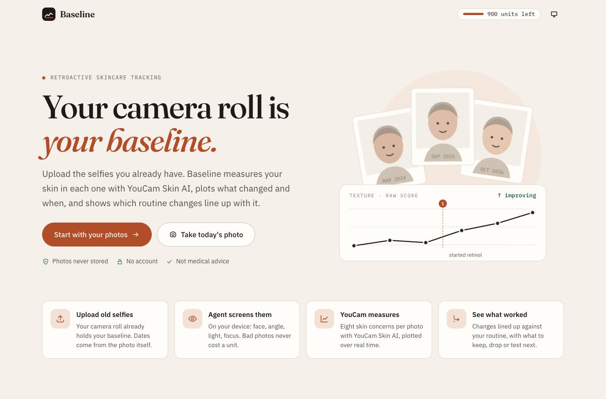
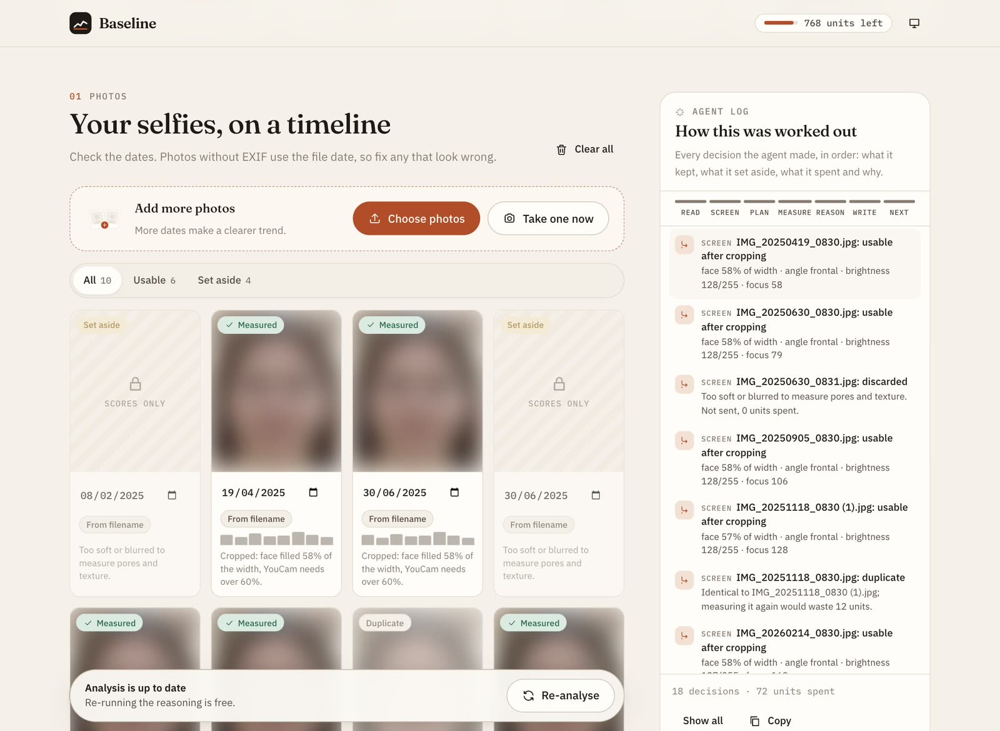
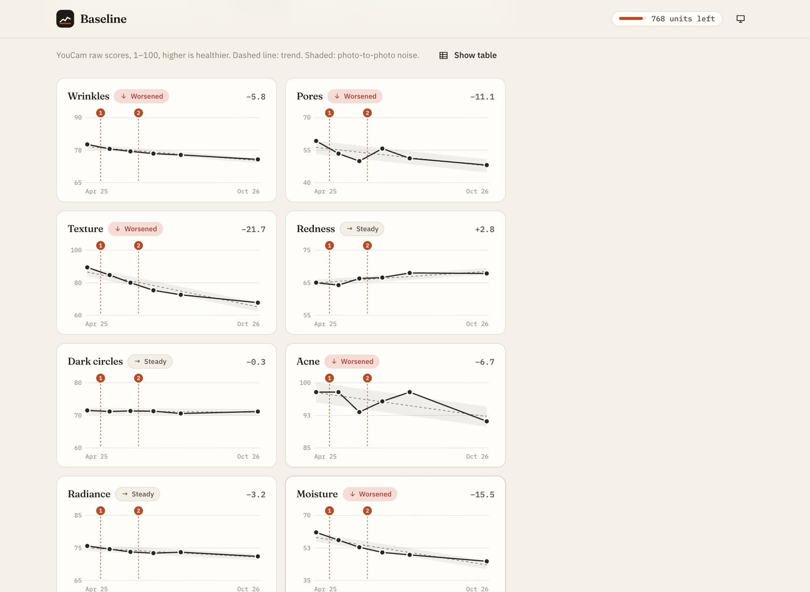
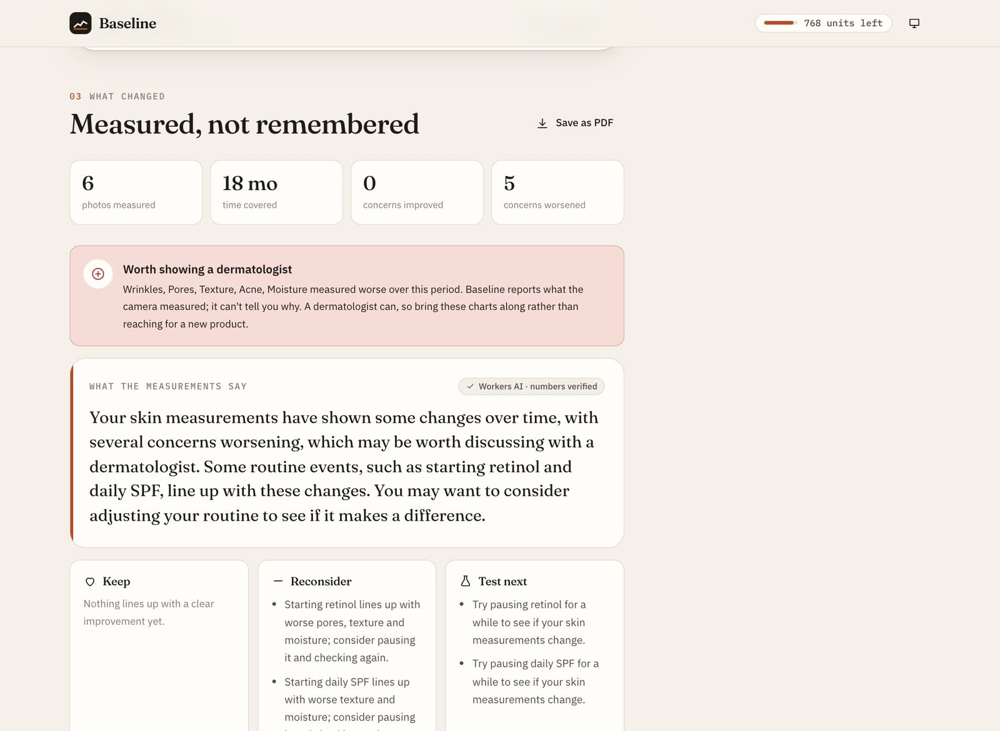
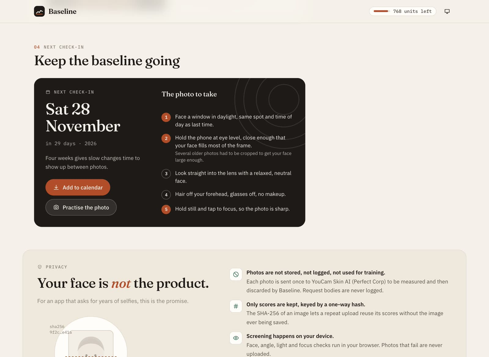
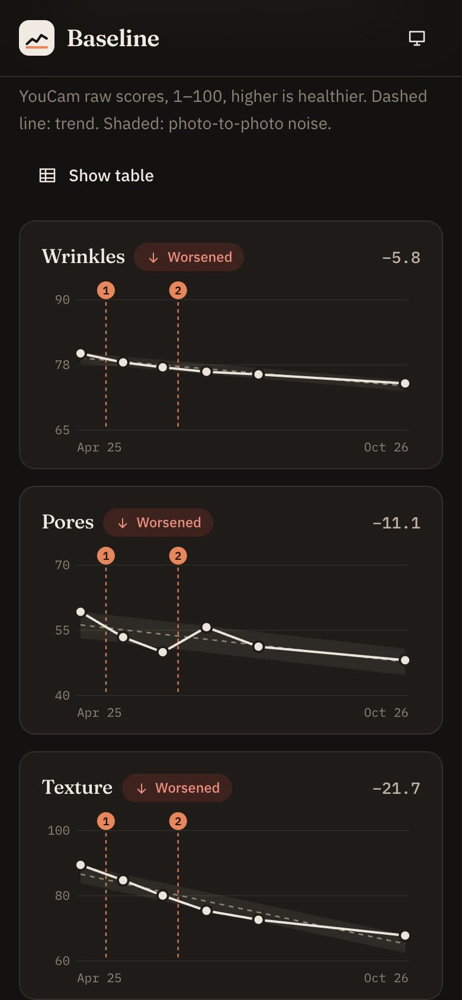
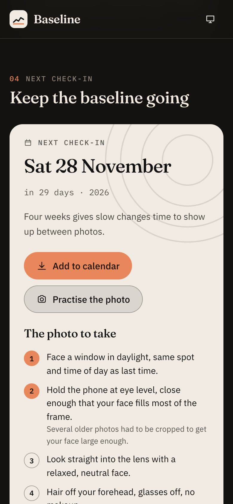

# Baseline

**Live: [https://baseline.sja-affu765.workers.dev](https://baseline.sja-affu765.workers.dev)**

Retroactive skincare efficacy tracking. Upload selfies you already have, and Baseline measures your skin in each one with **YouCam Skin AI**, plots every concern over real time, and shows which routine changes line up with what changed.



## The problem

People spend hundreds on skincare and can't tell whether any of it works. Memory and mirrors are unreliable, and skin changes too slowly to notice day to day. So people keep buying products that do nothing and abandon ones that were working.

Answering "did it work?" needs a measurement taken months ago, and nobody thinks to take one. But everyone already has it: hundreds of timestamped selfies in their camera roll. Baseline turns that camera roll into a baseline, so you can see what changed, and when, in about a minute.

## What it does

1. **Upload old selfies** (or take one now). Dates come from EXIF, then camera-roll filenames (`IMG_20240312…`, `PXL_…`), then the file date, and every date can be edited.
2. **An agent screens every photo on your device** before any API unit is spent: face found, one face, angle, head tilt, brightness, blown highlights, focus, resolution. Photos where the face is too small are rescued by cropping, so the face fills more than 60% of the width as YouCam requires.
3. **It plans the spend and asks you first.** It reuses cached results by image hash, drops exact duplicates, keeps the clearest photo per day, fits the shared unit budget by picking evenly spaced dates, and orders the queue earliest and latest first, then by largest gap. You see the plan, the order and the unit cost, and approve it.
4. **YouCam Skin AI measures eight concerns per photo**: wrinkles, pores, texture, redness, dark circles, acne, radiance and moisture. Raw scores are used, not the flattering `ui_score`.
5. **Each concern is plotted over time** as small multiples on a shared time axis, with a trend line, a photo-to-photo noise band, routine events marked, hover and keyboard tooltips, and a table view.
6. **The agent reasons over the series.** For each concern it fits a trend and compares the change with the noise. It sets aside outlier photos that jump on three or more concerns at once, since that usually means the lighting changed, not the skin. It compares averages before each routine change with averages from four weeks after.
7. **It writes the summary**: what improved, what got worse, and what to keep, reconsider or test next. If anything measured worse, it points you to a dermatologist, never to a product.
8. **It sets the next check-in.** The date follows your routine changes (roughly a 12-week trial), and it tells you which photo to take, tailored to what went wrong in your set. Add it to your calendar, or practise the shot with a live camera guide that coaches framing, angle, tilt and light on your device.

Everything the agent does is shown in the **"How this was worked out"** panel: each step, decision, unit spent and warning, in order.

### From a real run

These screenshots come from a real run on the live site. Six photos were measured by YouCam Skin AI for 72 units, and the summary was written by Workers AI and passed the number check.



Screening kept 6 of 10 photos. It set aside one too dark, two too blurred and an exact duplicate, all before spending a unit.





Five concerns measured worse in this set, so the summary points to a dermatologist rather than a product. The early photos were softer, and YouCam scored them as smoother skin.



<p>
  
  
</p>

<sub>The photos are edited copies of one synthetic, AI-generated face. They vary the lighting, colour and focus, and each date is set in the filename. Every thumbnail is blurred. No real person's face appears anywhere in this repo.</sub>

## The agent loop

| Phase | Where | What it decides |
| --- | --- | --- |
| Read | browser | Photo date from EXIF → filename → file date |
| Screen | browser (MediaPipe BlazeFace + pixel stats) | Usable, rescued by cropping, or set aside, with the reason. Free. |
| Plan | browser + worker | Cache hits, duplicates, one per day, budget fit, measurement order. Waits for your approval. |
| Measure | worker → YouCam | Upload, task, poll. Running unit tally. Failed photos are excluded and not charged. |
| Reason | browser | Trend vs noise per concern, outliers, before/after shift per routine event, dermatologist flag |
| Write | worker → Workers AI | Plain-language summary, checked: any number not in the measurements, or any keep/drop the evidence doesn't support, gets the write-up rejected in favour of the rule-based one |
| Schedule | browser | Next check-in date and photo instructions, `.ics` download |

**Never inventing a measurement** is enforced in code. Every number comes from YouCam's raw scores. The language model only explains findings that were computed deterministically, and its output is validated before it's shown.

## Privacy

- **Photos are not stored, not logged and not used for training.** Each photo is sent once to YouCam Skin AI to be measured. The worker holds it in memory only for that request, and request bodies are never logged.
- **Only scores are kept**, keyed by the photo's SHA-256 hash. Mask image URLs returned by YouCam are dropped.
- **Screening runs on your device**, so photos that fail are never uploaded.
- **EXIF and GPS are stripped:** photos are re-encoded in the browser before upload.
- **No accounts.** Your timeline (scores, dates, routine) stays in your browser's local storage until you press Clear all.
- Visitor limits use a salted daily hash of the IP address; the IP itself is never stored.

## Not medical advice

Baseline reports what YouCam Skin AI measured and how it changed. It doesn't diagnose anything or recommend products. If something measures worse, it tells you to see a dermatologist.

## YouCam API usage

- **YouCam Skin AI** (`/s2s/v2.0/file` → `/s2s/v2.0/task/skin-analysis`), SD, 8 concerns, 12 units per photo.
- Results are cached in Workers KV by image hash, so re-runs cost nothing.
- A shared budget (`UNIT_BUDGET`, default 900 of the 1,000 free units) and a daily per-visitor cap (`PER_VISITOR_DAILY`, default 12 photos) keep the demo available to everyone. Units are reserved when a task starts and refunded if it fails. KV has no atomic increment, so when two analyses finish at the same moment the shared counter can undercount by one photo. That's why 100 units stay in reserve.

## Stack

- React 18 + TypeScript + Vite, plain CSS design system (Fraunces, IBM Plex Sans and Mono), hand-drawn SVG illustrations and charts
- Cloudflare Workers (API + static assets), Workers KV (score cache, unit counter), Workers AI (`llama-3.3-70b-instruct-fp8-fast`)
- MediaPipe Tasks Vision face detector, on device
- exifr (lite) for EXIF dates

## Run it locally

Needs Node 20+ and a Cloudflare account for `wrangler`.

```bash
git clone https://github.com/sja-thedude/BaseLine.git
cd BaseLine
npm install
cp .env.example .dev.vars        # then put your YouCam API key in .dev.vars
npm run worker:dev               # builds the app and serves app + API on http://localhost:8787
```

For front-end work with hot reload, run `npx wrangler dev` in one terminal and `npm run dev` in another (Vite proxies `/api` to the worker). Workers AI only runs remotely, so locally the summary falls back to the rule-based write-up unless you use `wrangler dev --remote`.

Check your key with one real call (12 units):

```bash
YOUCAM_API_KEY=... npm run test:youcam -- path/to/selfie.jpg
```

### Deploy

```bash
wrangler kv namespace create baseline-cache   # put the id in wrangler.jsonc
wrangler secret put YOUCAM_API_KEY
npm run deploy
```

## Environment variables

| Name | Where | Purpose |
| --- | --- | --- |
| `YOUCAM_API_KEY` | Worker secret (`.dev.vars` locally) | YouCam API key |
| `UNIT_BUDGET` | `wrangler.jsonc` vars | Shared unit cap for visitors |
| `PER_VISITOR_DAILY` | `wrangler.jsonc` vars | New photos per visitor per day |

## Licence

[MIT](LICENSE)
